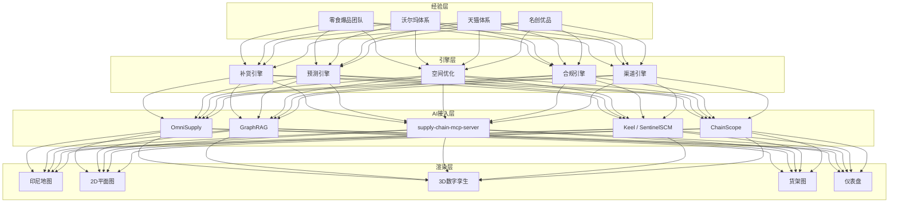

# nusantara-brand-os
Brand Landing OS for Indonesia · 食品 · 服装 · 新零食 · 快消
# 🇮🇩 Nusantara Brand OS

> **印尼品牌落地作战平台 · 可视化渲染 + 工具引擎 + 开源 AI 接入**
> 食品 · 服装 · 新零食 · 快消

<div align="center">

<p>
  
  
  
  
  
  
  
</p>

<p>
  
</p>

</div>

---

## 📖 项目简介

**Nusantara Brand OS** 是一个面向印尼市场的品牌落地一体化可视化平台。

我们不自己造 AI 模型，不重复造轮子，而是：

- **渲染层**：地图、2D 平面图、3D 数字孪生、货架图、热力图、仪表盘
- **引擎层**：补货、预测、空间优化、合规、渠道、生命周期
- **AI 层**：接入 OmniSupply、GraphRAG、supply-chain-mcp-server、Keel、ChainScope 等开源工具
- **经验层**：把中国零食爆品团队、沃尔玛体系、天猫体系、名创优品的方法论，变成平台里的规则、看板和引擎

> **核心价值：把中国顶级零售经验，翻译成印尼本地可执行动作的可视化作战平台。**

---

## 🧠 团队能力 × 平台模块

| 团队背景 | 核心能力 | 平台模块 | 沉淀方式 |
|----------|----------|----------|----------|
| **中国零食最知名团队** | 爆品策划、口味本地化、品类创新 | 选品看板、口味偏好分析、斋月礼盒策划 | 规则引擎 + 评分模型 |
| **沃尔玛团队及体系** | 供应链、WMS、门店运营、补货体系 | 补货引擎、WMS 可视化、门店数字孪生 | 安全库存 / ROP 模型 |
| **天猫体系** | 电商运营、流量投放、数据化选品 | 线上渠道看板、达人矩阵、直播 ROI | 渠道指标 + 数据看板 |
| **名创优品** | 选品、供应链、线下连锁、陈列管理 | 空间优化、货架图、SKU 去化、门店督导 | MILP 约束 + 陈列规则 |

> **你们缺的不是能力，是“载体”。这个平台把隐性经验变成印尼本地团队能直接用的显性工具。**

---

## 🏗 平台架构



---

## 🧩 核心模块

### 1. 合规看板
- BPOM / Halal / SNI 状态跟踪
- 认证到期预警
- 持证人链路可视化

### 2. 渠道地图
- Warung / Alfamart / Indomaret / 商场铺货
- 竞品密度
- TikTok GO 核销热力

### 3. 门店数字孪生
- 500㎡ / 2,000㎡ / 5,000㎡ 三档印尼主流门店
- 2D 平面图 + 3D 视图 + 货架图
- 编辑一次，双端同步

### 4. SKU 去化大屏
- 库存、FEFO、临期、缺货风险
- 批次、保质期、冷链温度
- 补货建议

### 5. 补货模拟器
- `LT_eff = LT_mean + k × σ_LT`
- 斋月因子、Mudik 效应
- 秒级输出补货方案

### 6. 空间优化器
- MILP 求解货架面位
- 单位面积利润 vs 缺货风险
- 优化前后对比

### 7. 风险监控
- 地缘、关税、物流中断
- 合规风险、供应商风险
- 开源工具接入：Keel、TG-RRNet、SentinelSCM

---

## 🤖 开源 AI 工具接入

| 工具 | 用途 | 接入方式 |
|------|------|----------|
| **supply-chain-mcp-server** | UN Comtrade / 世界银行数据 | MCP |
| **OmniSupply** | 多智能体供应链分析 | API / 自部署 |
| **GraphRAG** | 供应商-产品-合规知识图谱 | Neo4j |
| **Scope.Vantage** | HHI 集中度风险 | AWS Bedrock |
| **Keel** | AI 交付风险情报 | 多智能体 |
| **ChainScope** | 全球供应链可视化 | 仪表盘组件 |
| **SentinelSCM** | 多智能体控制塔 | LangGraph |
| **SynthFirm** | 货运需求模拟 | 基于 Agent |
| **InventOpt / SupplyNetPy** | 物流网络仿真 | 离散事件 |

---

## 🛠 技术栈

| 模块 | 技术 |
|------|------|
| 前端框架 | React 18 + TypeScript + Vite |
| 2D 平面图 | Konva.js / SVG |
| 3D 数字孪生 | React Three Fiber + Drei |
| 地图 | Mapbox / Deck.gl |
| 图表 | ECharts / D3 |
| 网络图 | VisuallyJs |
| 状态管理 | Zustand / Redux |
| 后端 | FastAPI |
| 数据库 | PostgreSQL + PostGIS |
| 缓存 | Redis |
| 优化求解 | OR-Tools (MILP) |
| 需求预测 | Prophet / LightGBM |
| 部署 | Cloudflare Pages + Railway / Fly.io |

---

## 🚀 快速开始

### 环境要求

- Python ≥ 3.10
- Node.js ≥ 18
- PostgreSQL ≥ 15 + PostGIS
- Docker（推荐）

### 本地开发

```bash
# 1. 克隆仓库
git clone https://github.com/YOUR_ORG/nusantara-brand-os.git
cd nusantara-brand-os

# 2. 初始化环境
cp .env.example .env
docker compose up -d db

# 3. 安装依赖并初始化
make install
make migrate
make seed

# 4. 启动前后端
make dev
```

打开浏览器访问 `http://localhost:5173` 即可体验 Demo。

### 生成一个 2,000㎡ 雅加达门店

```python
from nbo import StoreProfile, BrandTwin

store = StoreProfile(
    store_size_sqm=2000,
    island_region="java",
    target_sku_count=12000,
    fresh_ratio=0.28,
    qris_enabled=True,
)

twin = BrandTwin(store)
twin.load_planogram()
twin.forecast(horizon_days=30, include_ramadan=True)
twin.replenish()
twin.render_3d()
```

---

## 📁 项目结构

```text
nusantara-brand-os/
├── data/
│   ├── schemas/                  # 统一数据模型
│   └── seeds/                    # 三档门店种子数据
│       ├── store_500sqm.json
│       ├── store_2000sqm.json
│       └── store_5000sqm.json
├── src/
│   └── nbo/
│       ├── model/                # 实体与数据模型
│       ├── forecast/             # 需求预测引擎
│       ├── replenishment/        # 补货引擎
│       ├── space/                # 空间-存量优化
│       ├── lifecycle/            # FEFO / 促销触发
│       ├── sentiment/            # 舆情信号适配器
│       └── calendar/             # 印尼节庆日历
├── web/
│   ├── floorplan/                # 2D 平面图编辑器
│   ├── three/                    # 3D 数字孪生渲染
│   └── dashboard/                # SKU 去化大屏
├── integrations/
│   ├── mcp/                      # supply-chain-mcp-server
│   ├── omnisupply/
│   ├── graphrag/
│   ├── keel/
│   └── chainscope/
├── tests/
├── docs/
│   ├── assets/                   # README 图像与 GIF
│   ├── architecture.md
│   ├── store-scale-benchmarks.md
│   ├── indonesia-market-notes.md
│   └── data-model.md
├── .github/workflows/
├── docker-compose.yml
├── Makefile
└── README.md
```

---

## 🗺 路线图

| 阶段 | 时间 | 内容 | 状态 |
|------|------|------|------|
| **MVP** | 0–3 月 | 地图 + 合规 + 渠道 + 库存 + 补货建议 | 🔄 进行中 |
| **V1** | 3–6 月 | 2D 平面图 + 3D 数字孪生 + 预测引擎 + 斋月因子 | ⏳ 计划中 |
| **V2** | 6–9 月 | MILP 空间优化 + 风险监控 + 开源 AI 工具接入 | ⏳ 计划中 |
| **V3** | 9–12 月 | 多智能体 + 全量工具矩阵 + 印尼试点 | ⏳ 计划中 |

---

## 🤝 贡献指南

欢迎提交 PR 和 Issue。请遵循以下约定：

- **分支命名**：`feat/`、`fix/`、`docs/`、`chore/`
- **提交信息**：遵循 [Conventional Commits](https://www.conventionalcommits.org/)
- **代码风格**：ESLint + Prettier（前端），Ruff + Black（Python）
- **测试**：新增功能需附带测试用例
- **文档**：新增模块需更新对应 `docs/` 文件

### Issue 标签

| 标签 | 说明 |
|------|------|
| `compliance` | BPOM / Halal / SNI 相关 |
| `channel` | 渠道铺货、TikTok GO |
| `replenishment` | 补货引擎、安全库存 |
| `3d` | 数字孪生、Three.js |
| `ai-integration` | 开源 AI 工具接入 |
| `data-model` | 数据模型与 Schema |

---

## 📄 许可证

MIT License

---

## 🙏 致谢

- 视觉与展示范式参考：[ChargeNexus Showcase](https://github.com/vfvincentwong2026/charge-nexus-showcase)
- 印尼市场参数参考：APPBI 行业报告、Alfamidi / Alfasupermarket / Hypermart 公开数据
- 开源零售与供应链社区：Prophet、OR-Tools、React Three Fiber
- 开源 AI 工具：OmniSupply、GraphRAG、supply-chain-mcp-server、Keel、ChainScope、SentinelSCM、SynthFirm、InventOpt 等
- 中国零食、沃尔玛、天猫、名创优品团队经验沉淀

---

<div align="center">

**Nusantara Brand OS — 让中国零售经验，在印尼可执行。**

**Nusantara Brand OS — Let Chinese retail expertise become executable in Indonesia.**

</div>
